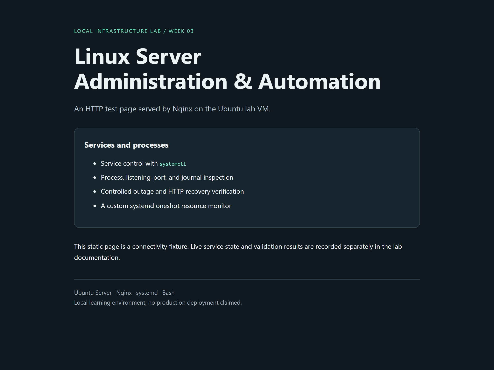
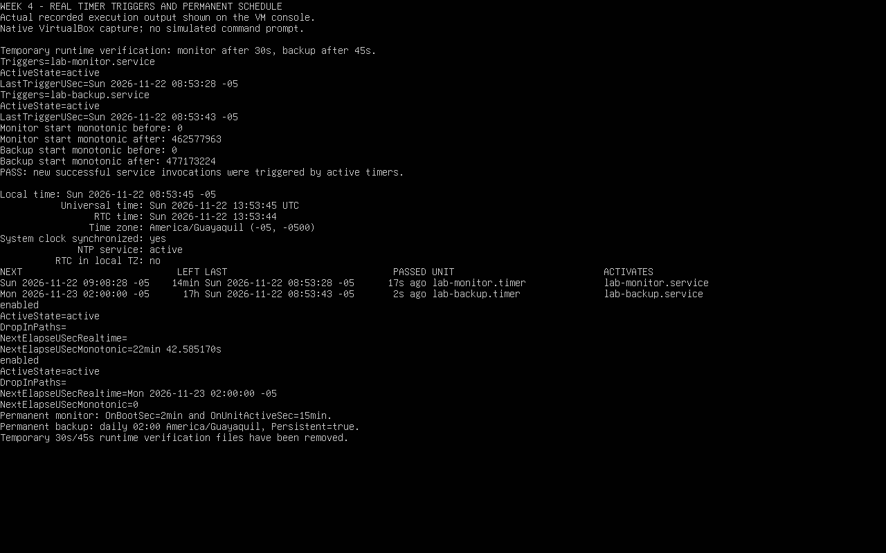
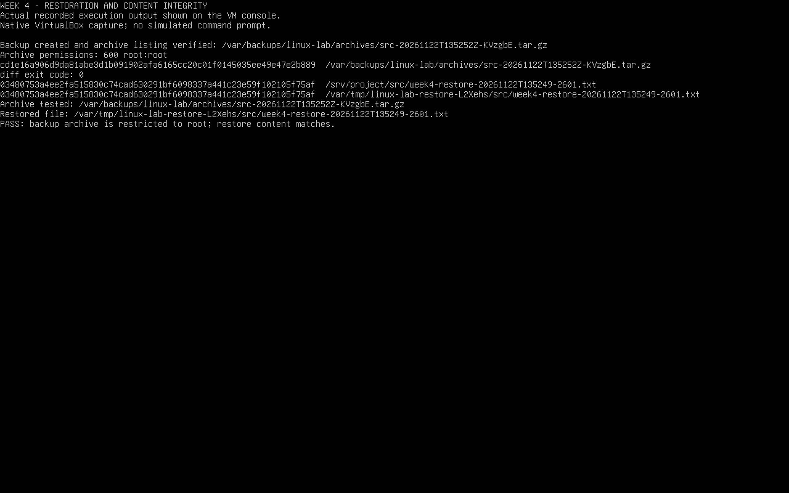

# Linux Server Administration & Automation

Hands-on Ubuntu Server lab demonstrating access control, secure remote administration, service troubleshooting, Bash reporting, scheduled backups, and verified recovery.

**Core lab completed and verified: 2026-11-22.** Three operational Bash scripts, two systemd services, two timers, and 44 screenshots document the work. A restored file matched its original with diff exit code 0 and identical SHA256 values.

## Demonstrated skills

| Area | Verified work | Evidence |
| --- | --- | --- |
| Server administration | VirtualBox VM, baseline, SSH, timezone, recovery checkpoint | [01 - Server setup](docs/01-server-setup.md) |
| Identity and security | Shared development access, read-only auditor, key-only SSH, effective allowlist, restricted UFW | [02 - Users and security](docs/02-users-permissions.md) |
| Service operations | Nginx HTTP access from Windows, process/log inspection, controlled interruption and recovery, limited operator sudo | [03 - Services and processes](docs/03-services-processes.md) |
| Automation and recovery | Read-only reports, real timer triggers, protected backups, scoped retention, matching restore | [04 - Automation and recovery](docs/04-automation.md) |
| Filesystem operations | Setgid, sticky bit, symlinks, searches, disk/inode and mount inspection | [Additional filesystem lab](docs/05-filesystem.md) |

## Lab architecture

```text
Windows host (OpenSSH / browser / VirtualBox)
    |
    | Bridged local management LAN: 192.168.100.0/24
    v
Ubuntu Server 26.04.1 LTS - linux-server
    |-- SSH: keys only; devops/admin allowlist
    |-- Nginx: subnet-restricted HTTP test page
    |-- Monitor: read-only oneshot + approximately 15-minute timer
    `-- Backup: root-only source archives + daily 02:00 timer
```

Configured resources: 2 vCPU, 2 GB RAM, 25 GB VDI. Server timezone: America/Guayaquil. The guide's Ubuntu 24.04/NAT + Host-only baseline was adapted to the existing Ubuntu 26.04/bridged lab and `/srv/project` paths; the actual differences and test results are documented.

**Technologies:** Ubuntu Server, VirtualBox, OpenSSH, UFW, Nginx, Bash, systemd, GNU tar, SHA256, Git.

## Validation results

| Test | Result |
| --- | --- |
| Administrative key login | Fresh devops/admin connections succeeded with separate keys |
| Denied access | Password-only SSH, disallowed developer SSH, auditor writes, and unrelated operator sudo were rejected |
| Web recovery | Windows HTTP 200 before/after a controlled outage; connection refused while Nginx was stopped |
| Service reporting | Manual and systemd monitor execution succeeded |
| Scheduling | Both enabled timers generated real service invocations; temporary test overrides were removed |
| Backup recovery | Protected compressed archive restored separately; diff 0 and matching file hashes |
| Retention | Aged matching fixture removed; unrelated file/directory preserved |

The final daily backup schedule was verified as 02:00 Guayaquil time. Automatic execution was exercised with documented temporary runtime delays; the session did not wait overnight or claim to observe a future daily run.

## Selected evidence

### HTTP service available from Windows

Installed Nginx on Ubuntu and published an English lab page. Opening it in the Windows browser confirmed that the host could reach the VM over the management LAN and that Nginx served the expected content.



### Timer execution and permanent schedules

Configured systemd timers for monitoring and backups, then used temporary short delays to verify that both triggered successful service runs automatically. The capture records those triggers and the permanent schedules after removing the test overrides: monitoring approximately every 15 minutes and backups daily at 02:00 Guayaquil time.



### Backup restore and integrity

Backed up `/srv/project/src` and restored a reference file into a separate directory. Comparing the original and restored files returned `diff` exit code 0 and identical SHA256 hashes, confirming that the tested file was recovered without content changes.



The browser capture renders the real server page. Console captures display actual saved execution records, without simulated prompts or the Windows mouse pointer. Stage documents contain the full evidence and provenance.

## Repository layout

```text
.
|-- README.md
|-- CHANGELOG.md
|-- docs/                   # Four core stages + filesystem extension
|-- scripts/
|   |-- lab-monitor.sh
|   |-- user-report.sh
|   |-- lab-backup.sh
|   `-- week*-*.sh          # Lab deployment and acceptance workflows
|-- configs/
|   |-- ssh/
|   |-- nginx/
|   |-- sudoers/
|   |-- project/
|   `-- systemd/            # Two services and two timers
`-- screenshots/            # 44 documented evidence images
```

Linux scripts/configurations retain LF line endings. Installed operational scripts, units, and the on-server English directory reference were checked against their local SHA256 values. See the [change history](CHANGELOG.md) for implementation and publication milestones.

## Engineering findings and scope

- Setgid supplies group inheritance; file modes and umask still determine shared write access.
- A successful oneshot normally becomes inactive after it exits. The result, exit status, and journal establish success.
- Recovery requires more than a readable archive: a separate restore and content comparison verified this backup.
- The live snapshot attempt stalled; an approved recovery restart and a disk-only cold checkpoint were used. Boot, services, SSH, and later automation were verified separately.

This is a local learning lab. Backups are stored within the VM, HTTP is limited to the management LAN, and off-host storage/alerting/cloud deployment are optional extensions. **114 available package updates were recorded from the existing APT metadata at closeout; Ubuntu upgrades were intentionally deferred as a separate maintenance task.** Completion refers to the core lab acceptance tests, not production readiness or a fully patched OS.

Passwords, private keys, real backup archives, raw execution logs, and personal planning files are excluded from Git.
