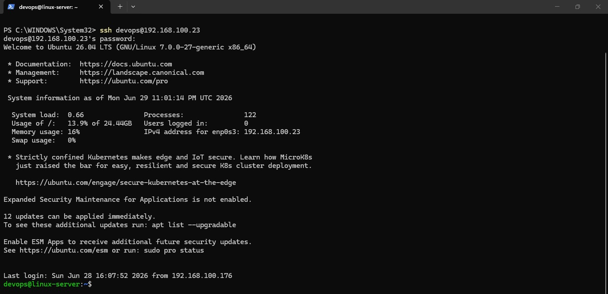

# Linux Server Administration & Automation

Hands-on Ubuntu Server lab demonstrating remote administration, local identity management, Linux permissions, and filesystem operations. The remaining stages cover secure SSH access, Nginx, and Bash automation with systemd.

**Status: in progress.** Existing work is documented with 23 original screenshots. Firewall hardening, service deployment, and automated backup recovery are pending.

## Demonstrated skills

| Area | Work documented | Evidence |
| --- | --- | --- |
| Server administration | VirtualBox installation and SSH access from Windows | [Server setup](docs/01-server-setup.md) |
| Identity and access | Role-based accounts, groups, sudo checks, and SSH user allowlist | [Users and permissions](docs/02-users-permissions.md) |
| Filesystem operations | Ownership, setgid, sticky bit, symlinks, file searches, disk and mount inspection | [Filesystem lab](docs/05-filesystem.md) |
| Troubleshooting | Network adapter change to restore connectivity; denied deletion in a sticky-bit directory | [Setup findings](docs/01-server-setup.md#troubleshooting) and [permission test](docs/05-filesystem.md#observed-access-control-test) |

## Lab environment

```text
Windows host (PowerShell / SSH client)
    |
    | Local network through a bridged VirtualBox adapter
    v
Ubuntu Server 26.04 LTS VM
    |-- devops: administrative account
    |-- dev / cloud / admin: role-based test accounts
    `-- /srv/project: permissions and filesystem exercises
```

Recorded resources: 2 GB RAM and a 25 GB virtual disk. Hostname: `linux-server`.

The reference guide uses Ubuntu 24.04, NAT + Host-only, and `/srv/lab`. This repository preserves the existing 26.04 lab, bridged network, account names, and `/srv/project` paths. The management network and final access policy still need validation against the guide's requirements.

**Tools used:** Ubuntu Server, VirtualBox, OpenSSH, Bash command line, Linux filesystem utilities, Git. Nginx, UFW, and systemd automation belong to the remaining scope.

## Documentation and progress

| Stage | Scope | Status |
| --- | --- | --- |
| [01 - Server setup](docs/01-server-setup.md) | VM, networking, remote access | Existing setup documented; full baseline checks remain |
| [02 - Users, permissions and security](docs/02-users-permissions.md) | Accounts, sudo, SSH, firewall | Accounts and allowlist documented; SSH keys and UFW pending |
| [03 - Services and processes](docs/03-services-processes.md) | Nginx, logs, recovery | Planned |
| [04 - Automation and recovery](docs/04-automation.md) | Bash, timers, backup restoration | Planned |
| [05 - Filesystem operations](docs/05-filesystem.md) | Additional original exercises | Documented; permission reconciliation pending |

## Repository layout

```text
.
|-- README.md
|-- CHANGELOG.md
|-- docs/                 # Four guide stages + original filesystem lab
|-- scripts/              # Delivery requirements; tested scripts pending
|-- configs/
|   |-- ssh/              # SSH configuration requirements
|   `-- systemd/          # Service and timer requirements
|-- screenshots/          # Original evidence with English filenames
`-- .gitignore
```

## Selected evidence

### Remote SSH access from Windows



### User privilege checks


### Sticky-bit access control


Full evidence is linked from each stage. Original captures retain their original language and terminal output.

## Engineering findings

- Setgid controls group inheritance. File modes and umask still determine group write access.
- The later filesystem exercise changes `src/` from a shared developer directory to an owner-writable directory. These access models need reconciliation before deployment.
- SSH account allowlisting, key authentication, and firewall restrictions require separate validation.

## Scope and verification

This is a local learning lab. Existing screenshots and notes establish the recorded results; this documentation update did not execute commands on the VM. Planned-stage checklists describe acceptance criteria, not completed tests.

Keep passwords, private keys, environment secrets, and real backup archives outside Git. See the [change history](CHANGELOG.md) for the original milestones and repository reorganization.
