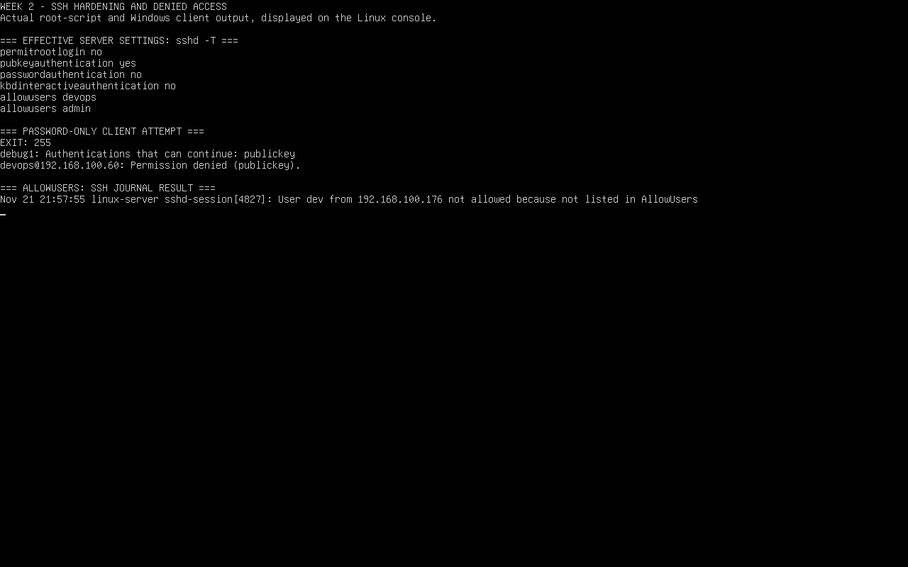
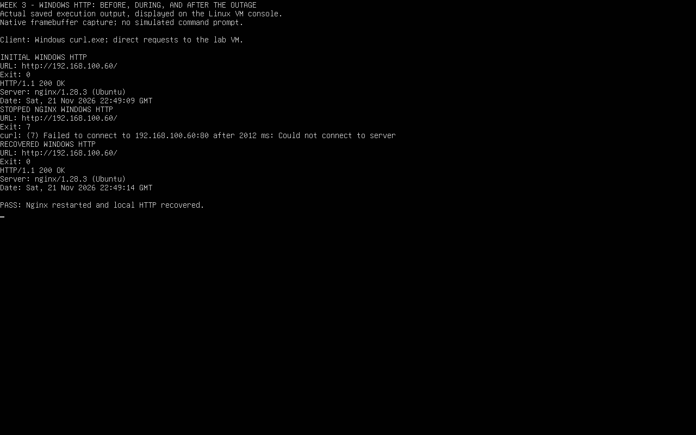

# Linux Server Administration & Automation

Hands-on Ubuntu Server lab demonstrating remote administration, local identity management, Linux permissions, and filesystem operations. SSH hardening, a restricted firewall, Nginx, and a custom systemd monitor are implemented. Scheduled automation and backup recovery are the remaining core stage.

**Status: in progress. Weeks 2 and 3 are complete.** Access controls, key-only SSH, UFW, Nginx recovery, and the monitor service are implemented and verified. The repository contains 34 screenshots. Scheduled monitoring, backup automation, and restoration remain pending.

## Demonstrated skills

| Area | Work documented | Evidence |
| --- | --- | --- |
| Server administration | VirtualBox installation and SSH access from Windows | [Server setup](docs/01-server-setup.md) |
| Identity and access | Shared source access, read-only audit role, sudo checks, key-only SSH, and restricted UFW | [Users and permissions](docs/02-users-permissions.md) |
| Filesystem operations | Ownership, setgid, sticky bit, symlinks, file searches, disk and mount inspection | [Filesystem lab](docs/05-filesystem.md) |
| Service operations | Nginx deployment, process/log inspection, verified HTTP recovery, oneshot monitor, and restricted operator sudo | [Services and processes](docs/03-services-processes.md) |
| Troubleshooting | Network adapter change to restore connectivity; denied deletion in a sticky-bit directory | [Setup findings](docs/01-server-setup.md#troubleshooting) and [permission test](docs/05-filesystem.md#observed-access-control-test) |

## Lab environment

```text
Windows host (PowerShell / SSH client)
    |
    | Local network through a bridged VirtualBox adapter
    v
Ubuntu Server 26.04 LTS VM
    |-- devops: administrative account
    |-- dev / cloud / admin: role-based test accounts
    `-- /srv/project: permissions and filesystem exercises
```

Recorded resources: 2 GB RAM and a 25 GB virtual disk. Hostname: `linux-server`.

The reference guide uses Ubuntu 24.04, NAT + Host-only, and `/srv/lab`. This repository preserves the existing 26.04 lab, bridged network, account names, and `/srv/project` paths. The final access policy is documented and tested in stage 02; the management subnet is the local bridged LAN.

**Tools used:** Ubuntu Server, VirtualBox, OpenSSH, UFW, Nginx, Bash, Linux filesystem utilities, systemd, Git. Scheduled monitoring and backups belong to the remaining scope.

## Documentation and progress

**Next guide stage: week 4.** Weeks 2 and 3 are verified. Week 1 still has baseline/snapshot/timezone evidence tasks. Chapter 05 is supplementary filesystem work, not a fifth week.

Week-2/3 deployment scripts, tested SSH/Nginx/operator configurations, the monitor script, and its oneshot unit now exist. The user-report/backup scripts, backup unit, and both scheduling timers remain pending.

| Stage | Scope | Status |
| --- | --- | --- |
| [01 - Server setup](docs/01-server-setup.md) | VM, networking, remote access | Existing setup documented; full baseline checks remain |
| [02 - Users, permissions and security](docs/02-users-permissions.md) | Accounts, sudo, SSH, firewall | Completed and verified, with new evidence |
| [03 - Services and processes](docs/03-services-processes.md) | Nginx, logs, recovery, monitor, limited sudo | Completed and verified, with six new captures |
| [04 - Automation and recovery](docs/04-automation.md) | Bash, timers, backup restoration | Monitor prerequisite complete; scheduling/recovery pending |
| [05 - Filesystem operations](docs/05-filesystem.md) | Additional original exercises | Documented; shared-source permissions reconciled in stage 02 |

## Repository layout

```text
.
|-- README.md
|-- CHANGELOG.md
|-- docs/                 # Four guide stages + original filesystem lab
|-- scripts/              # Tested week-2/3 scripts and resource monitor
|-- configs/
|   |-- ssh/              # Tested SSH hardening
|   |-- nginx/            # Installed site and HTTP test page
|   |-- sudoers/          # Exact Nginx operator restart policy
|   `-- systemd/          # Tested monitor unit; future timers
|-- screenshots/          # Original evidence with English filenames
`-- .gitignore
```

## Selected evidence

### HTTP service available from Windows


### SSH access controls



### Controlled outage and recovery



Full evidence is linked from each stage. The page capture is browser-native; console captures display actual saved execution records. Each stage documents provenance. Original milestone captures retain their original language and output.

## Engineering findings

- Setgid controls group inheritance. File modes and umask still determine group write access.
- The later filesystem exercise had removed developer write access. Week 2 reconciled it to `2770 devops:developers` and verified both shared writes and denied audit writes.
- SSH account allowlisting, key authentication, and firewall rules were validated separately. A timed rollback protected the change; only successful external key checks allowed confirmation.
- Nginx recovery was checked from both the guest and Windows: HTTP 200, refused connection while stopped, then HTTP 200 again. A completed monitor oneshot reports inactive with a successful exit.

## Scope and verification

This is a local learning lab. Original screenshots document prior milestones. Week-2/3 scripts were executed on the VM, with independent SSH/HTTP checks and real failure/recovery tests. Stage 04 clearly separates the completed monitor prerequisite from pending timers/backups.

Keep passwords, private keys, environment secrets, and real backup archives outside Git. See the [change history](CHANGELOG.md) for the original milestones and repository reorganization.
