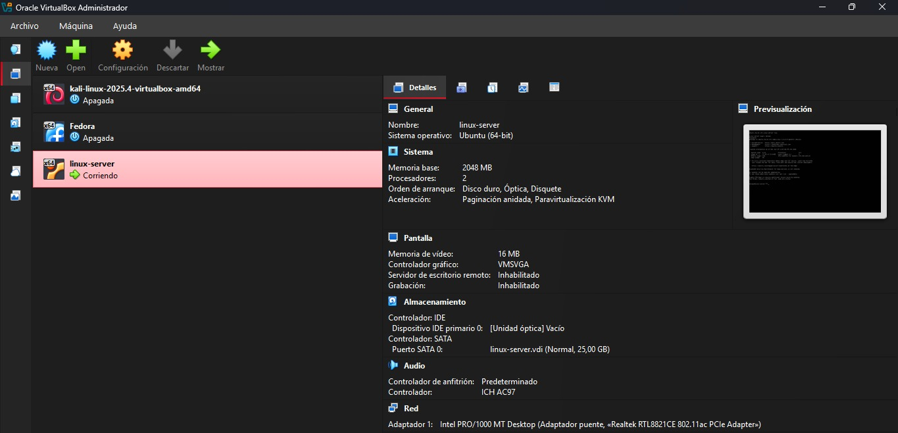
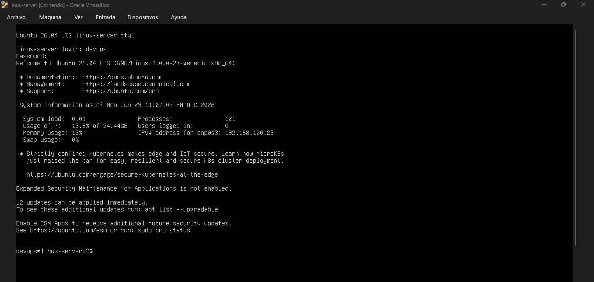

# 01 - Ubuntu Server Setup

[Back to project overview](../README.md)

## At a glance

| State | Meaning |
| --- | --- |
| Already documented | VM installation and remote SSH login are documented. |
| Remaining | Complete baseline, network, timezone, package-update, and SSH-status evidence. |
| Stage status | Existing setup; verification remaining. |

## Goal and status

Deploy a Linux VM and administer it remotely from Windows. The existing lab records successful SSH access. Additional baseline captures are needed to satisfy the full guide checklist.

## Recorded environment

| Component | Value |
| --- | --- |
| Hypervisor | VirtualBox |
| Guest OS | Ubuntu Server 26.04 LTS, visible in the SSH login banner |
| RAM | 2048 MB, recorded in the original notes |
| Virtual disk | 25 GB, recorded in the original notes |
| Networking | Bridged adapter, recorded in the original notes |
| Hostname | `linux-server` |
| Administrative account | `devops` |
| SSH client | Windows PowerShell |

The guide's Ubuntu 24.04 and NAT + Host-only configuration is a reference baseline. It has not been substituted for the actual environment. Private IP addresses in screenshots are historical lab values.

## Work recorded

1. Created the VirtualBox VM and installed Ubuntu Server.
2. Created `devops` and configured the hostname.
3. Updated packages, according to the original notes.
4. Installed OpenSSH during setup.
5. Connected from Windows using `ssh devops@<VM_IP>`.

The captures demonstrate the VM, initial terminal commands, and remote login. Package-update completion and a full hardware/network baseline need additional explicit evidence.

## Command reference

These commands summarize the original exercises; replace `<VM_IP>` with the current guest address.

| Command | Purpose |
| --- | --- |
| `uname -a` | Inspect kernel and system information |
| `df -h` | Inspect filesystem capacity |
| `free -h` | Inspect memory usage |
| `ip addr show` | Identify interface addresses |
| `sudo apt update && sudo apt upgrade -y` | Refresh package metadata and upgrade packages |
| `sudo hostnamectl set-hostname linux-server` | Set the guest hostname |
| `ssh devops@<VM_IP>` | Open a remote session from Windows |

## Troubleshooting

**Symptom:** the original notes report that the VM did not obtain a usable address during setup.

**Action recorded:** changed the VirtualBox adapter from NAT to bridged mode.

**Observed result:** Windows subsequently connected to the guest over SSH. The original notes do not establish the underlying DHCP failure; bridged mode is the workaround used in this lab.

## Evidence

## Remaining validation

- Capture `hostnamectl`, `cat /etc/os-release`, `ip -br addr`, `ip route`, `free -h`, and `df -h /` as a current baseline.
- Record vCPU count, adapter settings, and a baseline VirtualBox snapshot.
- Confirm the management network. If adopting NAT + Host-only, capture the new configuration and retest access.
- Verify `systemctl is-active ssh`, package update completion, and `timedatectl` with the intended timezone.
- Capture `whoami` and `hostname` inside a fresh remote session.
