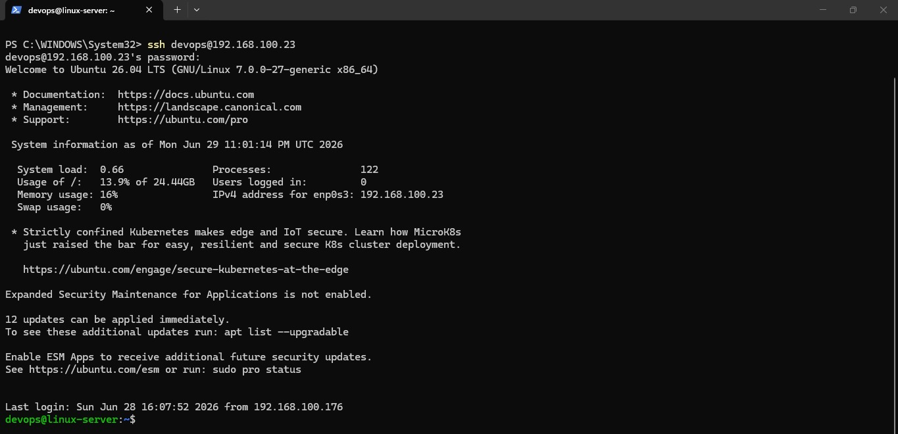
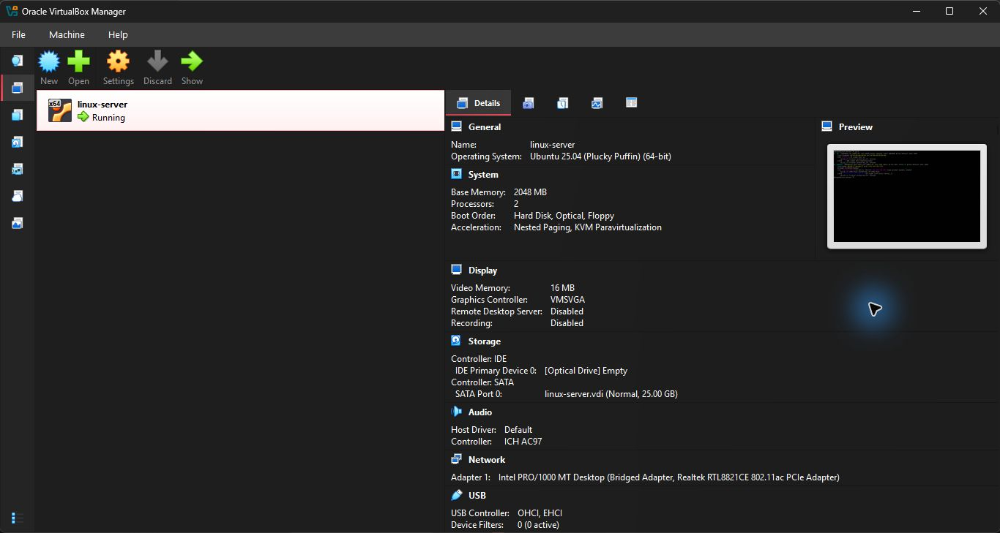
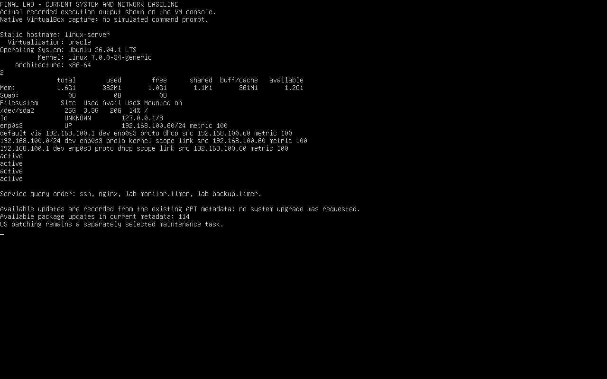
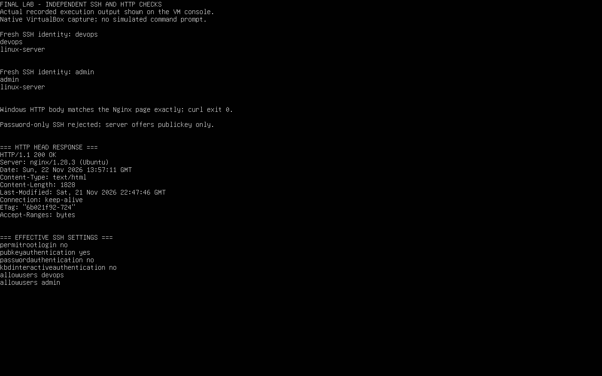
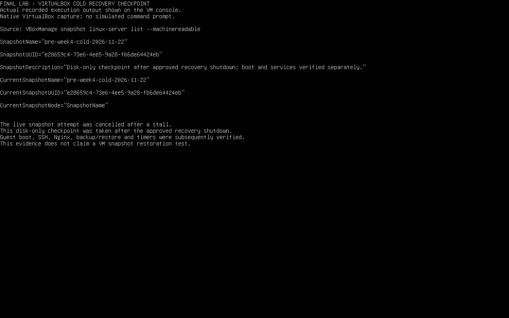

# 01 - Ubuntu Server Setup

[Back to project overview](../README.md)

## At a glance

| State | Meaning |
| --- | --- |
| Already documented | VM installation and remote SSH login are documented. |
| Remaining | Baseline, connectivity, timezone, and recovery-checkpoint evidence are complete; package upgrades are recorded separately as deferred maintenance. |
| Stage status | Baseline revalidated and core acceptance complete on 2026-11-22. |

## Goal and status

Deploy a Linux VM and administer it remotely from Windows. The original setup is preserved below. Current OS/network/resource checks, fresh SSH access, timezone, and a recovery checkpoint were revalidated during final closeout.

## Recorded environment

| Component | Value |
| --- | --- |
| Hypervisor | VirtualBox |
| Guest OS | Ubuntu Server 26.04 LTS, visible in the SSH login banner |
| vCPU | 2, verified in the current VirtualBox configuration capture |
| RAM | 2048 MB, verified in the current VirtualBox configuration capture |
| Virtual disk | 25 GB VDI, verified in the current VirtualBox configuration capture |
| Networking | Bridged adapter, verified in the current VirtualBox configuration capture |
| Hostname | `linux-server` |
| Administrative account | `devops` |
| SSH client | Windows PowerShell |

The guide's Ubuntu 24.04 and NAT + Host-only configuration is a reference baseline. It has not been substituted for the actual environment. Private IP addresses in screenshots are historical lab values.

## Work recorded

1. Created the VirtualBox VM and installed Ubuntu Server.
2. Created `devops` and configured the hostname.
3. Updated packages, according to the original notes.
4. Installed OpenSSH during setup.
5. Connected from Windows using `ssh devops@<VM_IP>`.

The original captures demonstrate the VM, initial commands, and remote login. Current baseline evidence and the explicit package-maintenance decision are documented in the final sections below.

## Command reference

These commands summarize the original exercises; replace `<VM_IP>` with the current guest address.

| Command | Purpose |
| --- | --- |
| `uname -a` | Inspect kernel and system information |
| `df -h` | Inspect filesystem capacity |
| `free -h` | Inspect memory usage |
| `ip addr show` | Identify interface addresses |
| `sudo apt update && sudo apt upgrade -y` | Refresh package metadata and upgrade packages |
| `sudo hostnamectl set-hostname linux-server` | Set the guest hostname |
| `ssh devops@<VM_IP>` | Open a remote session from Windows |

## Troubleshooting

**Symptom:** the original notes report that the VM did not obtain a usable address during setup.

**Action recorded:** changed the VirtualBox adapter from NAT to bridged mode.

**Observed result:** Windows subsequently connected to the guest over SSH. The original notes do not establish the underlying DHCP failure; bridged mode is the workaround used in this lab.

## Evidence

## Current VM configuration check

The VirtualBox Manager shows `linux-server` running with 2 processors, 2048 MB RAM, a 25 GB VDI, and a bridged network adapter. This screenshot verifies the hypervisor settings; it does not verify the current guest operating system release, SSH security policy, or firewall state.

The selected VirtualBox OS profile reads Ubuntu 25.04. That profile is metadata, not the installed OS. Guest checks confirmed Ubuntu 26.04.1 LTS; the historical record was not replaced with the profile label.

A later direct SSH connection using the dedicated lab Ed25519 key succeeded. Read-only checks confirmed hostname `linux-server`, Ubuntu 26.04.1 LTS, and the administrative account `devops`. The earlier authentication failure was resolved by authorizing the public key. No guest security settings were changed during these checks.

## Final baseline and connectivity

On 2026-11-22, the installer recorded hostname, OS/kernel, CPU count, memory, filesystem capacity, IPv4 interfaces/routes, service states, and effective SSH/UFW policy. Fresh independent devops/admin key sessions and Windows HTTP succeeded.

The server timezone is America/Guayaquil with clock synchronization active. Nginx and SSH are active; both operational timers are enabled and active. The capture's four service-state lines correspond to ssh, nginx, lab-monitor.timer, and lab-backup.timer.

## Recovery checkpoint and observed incident

The running-VM snapshot attempt stalled while saving state. It was cancelled through VirtualBox's cancelable progress API. The guest did not regain network connectivity or respond to an ACPI shutdown request. With explicit user authorization it was powered off and restarted, after taking the disk-only cold checkpoint `pre-week4-cold-2026-11-22` (UUID e28659c4-73e6-4ee5-9a28-fb6de64424eb).

The guest then booted, and SSH/Nginx were verified before week-4 installation. Automation, archive recovery, and final connectivity checks subsequently passed. This is a closeout recovery checkpoint after a forced shutdown, not a claim that the original installation snapshot was recorded or that full VM snapshot restoration was tested. The cause of the live-snapshot stall was not established.

## Package maintenance decision

The original notes record package preparation during installation, and the week-3 package transaction installed current Nginx packages from the configured repositories. At final closeout, existing APT metadata listed 114 available package updates. The user explicitly chose to record those as separate maintenance instead of performing an Ubuntu upgrade.

The core baseline/automation tests are complete; the lab is not represented as fully patched. Future maintenance should refresh metadata, review/apply updates, and recheck access/services. The existing bridged topology is intentional; a future NAT + Host-only change would require revalidating IP/subnet-based rules.
