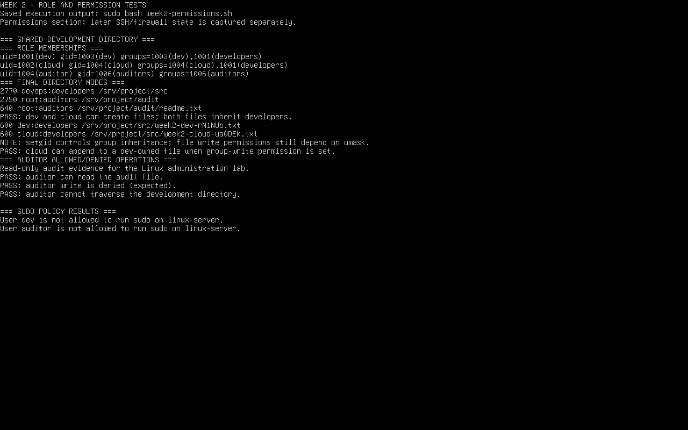
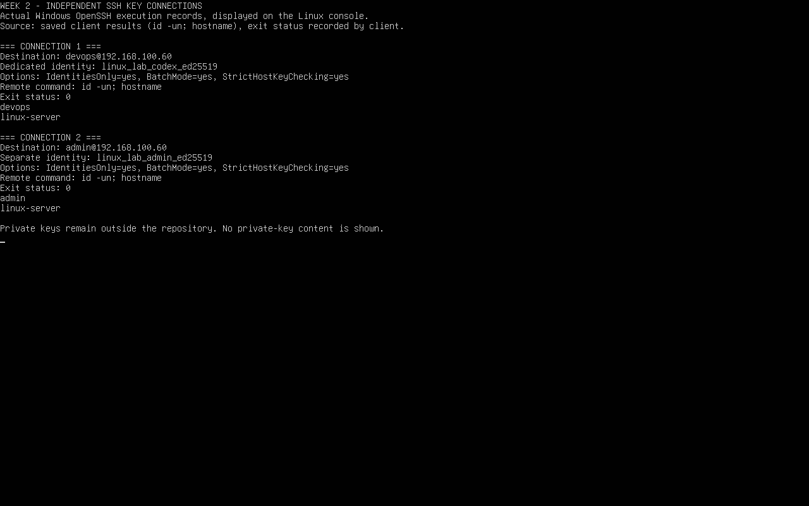
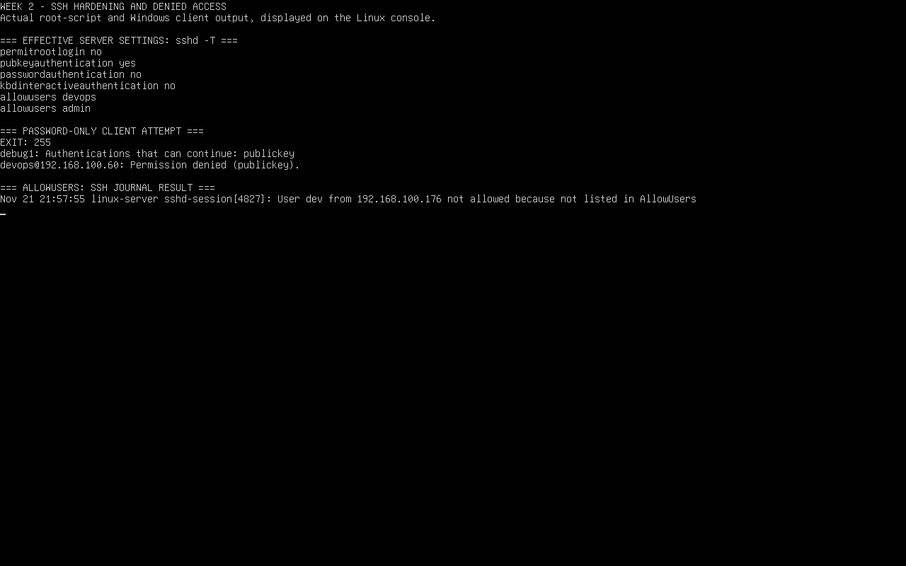
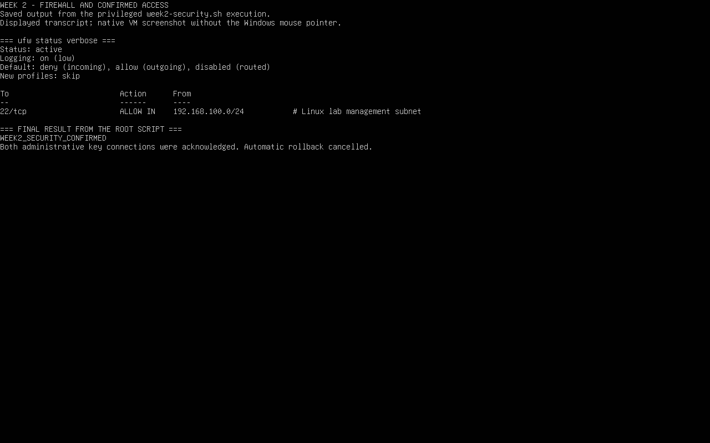

# 02 - Users, Permissions and Security

[Back to project overview](../README.md)

## At a glance

| State | Result |
| --- | --- |
| Completed | Shared development permissions, read-only audit role, allowed/denied access tests, separate SSH keys, SSH hardening, and UFW |
| Verified | Fresh devops/admin key sessions, rejected password-only login, dev denied by AllowUsers, successful protected confirmation |
| Evidence | Four new native VM captures linked below; original milestone evidence retained |
| Project status | Services and [automation/recovery](04-automation.md) are now complete |

**Week 2 completed and verified on 2026-11-21.** This is a local VirtualBox lab running Ubuntu Server 26.04.1 LTS.

## Goal

Separate project work from administration, demonstrate least privilege with real permitted/denied operations, and retain remote access while enabling key-only SSH and a restricted firewall policy.

## Final accounts and access

| Account | Relevant groups | Intended access |
| --- | --- | --- |
| devops | devops, sudo; existing installation memberships retained | Base administrator and project owner; dedicated SSH key |
| dev | developers | Shared source access; no sudo; no SSH access |
| cloud | developers | Shared source access; no sudo; no SSH access |
| admin | admins, sudo | Separate administrative account and SSH key |
| auditor | auditors | Read-only audit directory; no sudo; no SSH access |

The lab keeps the existing dev/cloud/admin names and `/srv/project` paths instead of recreating the guide's accounts and `/srv/lab`. The auditor role supplies the guide's read-only access-control exercise. The optional Nginx-only operator policy is now implemented and tested in stage 03.

## Final directory policy

| Path | Owner/group | Mode | Result |
| --- | --- | --- | --- |
| /srv/project | devops:developers | 755 | Administrator controls top-level entries; other roles can traverse |
| /srv/project/src | devops:developers | 2770 | Owner and developer group can work; setgid preserves group inheritance |
| /srv/project/audit | root:auditors | 2750 | Auditor group can read/traverse but cannot create entries |
| /srv/project/audit/readme.txt | root:auditors | 640 | Root writes; auditors read |

The earlier filesystem exercise had left source at `2755 devops:devops`, which prevented dev/cloud group writes. [week2-permissions.sh](../scripts/week2-permissions.sh) recorded prior modes/owners, reconciled the source tree's group access without following symlinks or crossing mounts, and created the audit role. Existing file owners and executable bits were retained.

## Permission and privilege tests

The privileged script returned `WEEK2_PHASE1_COMPLETE` with these observed results:

- dev and cloud each created a source file; both new files inherited developers.
- cloud appended to a dev-owned test file after group write permission was set.
- auditor read the audit reference file, but file creation was denied.
- auditor could not traverse the private source directory.
- Sudo policy denied administrative commands to dev and auditor.

Setgid controls group inheritance; it does not grant write access to every new file. The creation tests produced mode 600 files because mktemp uses restrictive modes. The separate shared-write test explicitly set group write access. Umask and file modes remain relevant for future development tools.



## SSH configuration and validation

Dedicated Ed25519 identities were used for devops and admin. Private keys remain outside the repository. Fresh Windows OpenSSH sessions ran `id -un` and `hostname` successfully under each account using its own identity, `IdentitiesOnly=yes`, `BatchMode=yes`, and strict host-key checking.



The installed [00-lab-hardening.conf](../configs/ssh/00-lab-hardening.conf) matches the local copy byte for byte and sets:

```text
PasswordAuthentication no
KbdInteractiveAuthentication no
PubkeyAuthentication yes
PermitRootLogin no
```

The existing main `/etc/ssh/sshd_config` retains:

```text
AllowUsers devops admin
```

The script checked `sshd -t` and effective settings with `sshd -T` before reloading. Subsequent independent tests confirmed:

- Both administrative keys still authenticated after SSH/UFW changes.
- A password-only client attempt failed with exit code 255; the server offered publickey only.
- A dev login attempt was denied. The journal explicitly recorded that dev was not listed in AllowUsers, establishing the reason for denial.



## Firewall policy

The actual bridged lab network is `192.168.100.0/24`. UFW is active with default deny incoming, allow outgoing, and an inbound TCP 22 rule restricted to that subnet. At the week-2 checkpoint, IPv6 support was enabled and no IPv6 SSH allow rule or HTTP rule had been added. Stage 03 later added IPv4 HTTP from the same management subnet.

This is the local LAN used by the bridged VM, not an isolated Host-only network. Restricted UFW rules do not make the entire LAN trusted in a production sense. Migrating to NAT + Host-only remains a possible lab improvement.

The root script backed up the previously inactive policy before replacing its rules. `ufw status verbose` verified the installed policy, and fresh connections from the management subnet succeeded. No connection from a separate external subnet was simulated, so that specific network test is not claimed.



## Safe change and recovery procedure

[week2-security.sh](../scripts/week2-security.sh) waits for the external verifier before changing access settings. It records prior state under a root-only backup path and arms a 10-minute rollback before applying SSH/UFW changes. It confirms only after acknowledgement files from independently authenticated devops and admin sessions arrive. Markers use a run-specific token, must have the expected owner, cannot be symlinks, and are never executed as root.

An earlier run demonstrated the timed rollback when manual confirmation missed the deadline. The revised run returned `WEEK2_SECURITY_CONFIRMED`, cancelled the timer, and retained the tested settings. A subsequent timer listing found no scheduled week-2 rollback. The permission changes from phase 1 are independent of that rollback.

## Evidence provenance

The four new images are native VirtualBox framebuffer exports without the Windows mouse pointer. The console displays actual saved execution output and independent Windows SSH client results; it does not simulate command prompts or present the images as live captures of the original Windows terminal session. Raw transcripts are retained locally and ignored by Git. The first image shows only permission results so that the earlier pre-hardening SSH/firewall state is not confused with the final state.

## Earlier milestone evidence

These original captures document the earlier exercises. They precede the final changes above.

| Evidence | Original result |
| --- | --- |
| [Groups](../screenshots/users-01-groups-created.jpeg) | developers and admins creation |
| [Accounts](../screenshots/users-02-users-and-ids.jpeg) | Initial account IDs and memberships |
| [Project layout](../screenshots/users-03-project-structure.jpeg) | Original directory exercise |
| [Sudo checks](../screenshots/users-04-sudo-privileges.jpeg) | dev denied; admin privileged |
| [SSH allowlist](../screenshots/users-05-ssh-allowusers-config.jpeg) | Main configuration edit |
| [SSH service](../screenshots/users-06-ssh-service-status.jpeg) | Active SSH service |
| [Account report](../screenshots/users-07-real-users.jpeg) | Original UID-based listing |

## Next work

[Stage 03](03-services-processes.md) is now complete: Nginx, subnet-restricted HTTP, process/log inspection, service recovery, and restricted operator sudo were verified. [Week 4](04-automation.md) is now complete, including timers, retention, and verified restoration. The [baseline and recovery checkpoint](01-server-setup.md) were also revalidated during closeout.
