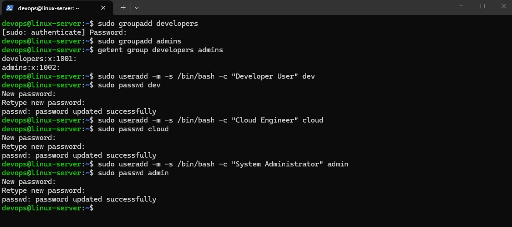
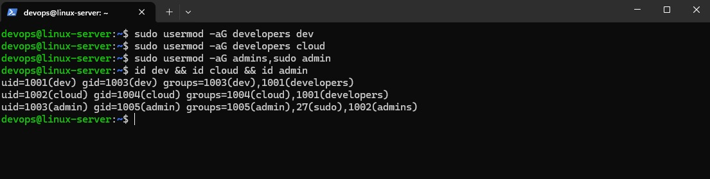
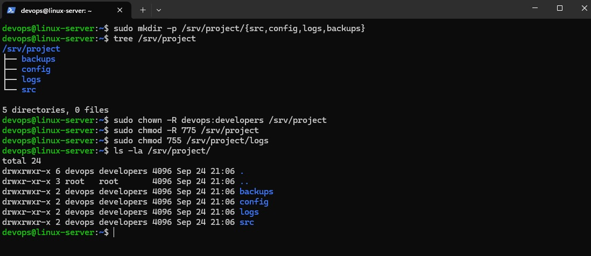
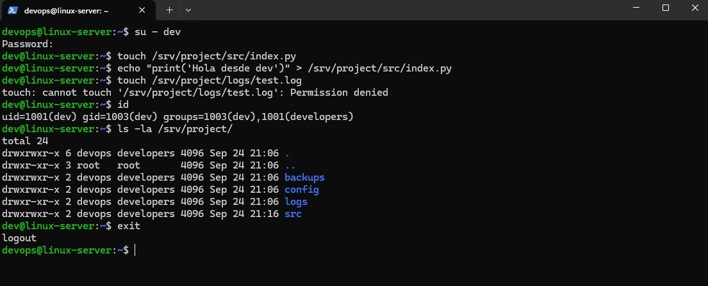
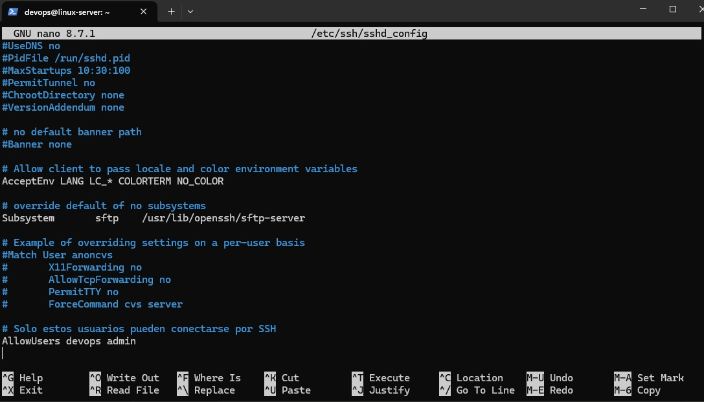
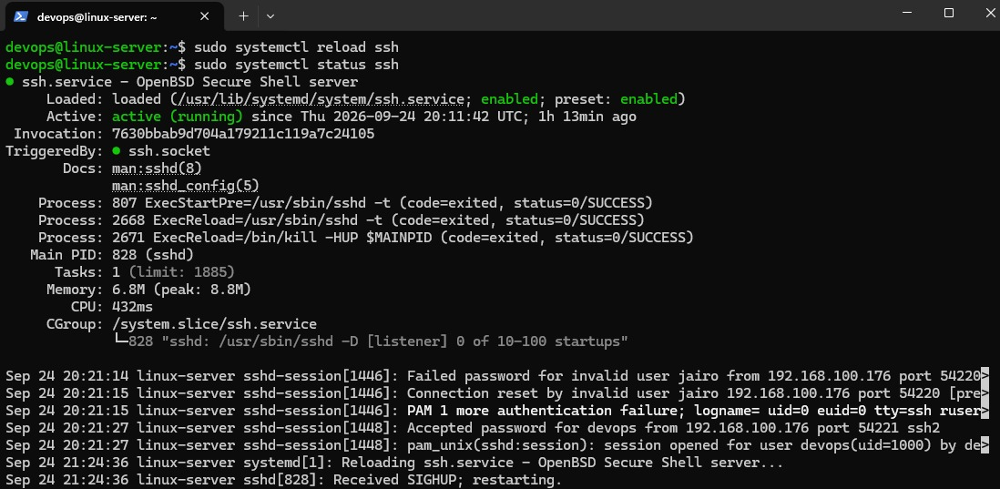
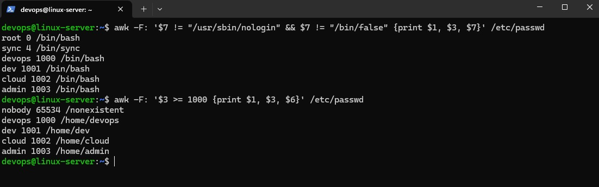

# 02 - Users, Permissions and Security

[Back to project overview](../README.md)

## Goal and status

Separate administrative access from project work and apply explicit ownership and permissions. Users, groups, sudo checks, and an SSH allowlist are documented. Key-based login, effective SSH hardening, and UFW validation are pending.

## Recorded accounts

| Account | Primary group | Supplementary groups | Intended access |
| --- | --- | --- | --- |
| `devops` | Existing installation account | Reconfirm current memberships | Base administrator and original project owner |
| `dev` | `dev` | `developers` | Development work without sudo |
| `cloud` | `cloud` | `developers` | Project work without sudo |
| `admin` | `admin` | `admins`, `sudo` | Administration |

These names differ from the guide's `developer`, `operator`, and `auditor`. A read-only audit role and a narrowly scoped operator sudo policy have not been demonstrated.

## Original shared directory model

```text
/srv/project/        devops:developers, mode 775
|-- src/             mode 775 plus setgid (2775)
|-- config/
|-- logs/            mode 755
`-- backups/
```

The original notes record a group-inheritance exercise using two accounts. Setgid makes new entries inherit the directory's group; it does not itself grant group write permission. Umask and file modes still matter.

Mode `2775` also permits access to other local users, making it broader than the guide's `2770` engineering directory. The [later filesystem exercise](05-filesystem.md) records `src/` as `devops:devops` with mode `755`, changing the collaboration policy. Recheck the VM and settle the final policy before deployment.

## Commands used in the exercises

| Command | Purpose |
| --- | --- |
| `groupadd developers` | Create the project group |
| `useradd -m -s /bin/bash -c "Development account" dev` | Create a home directory and Bash account |
| `usermod -aG developers dev` | Append supplementary group membership |
| `id dev` | Inspect UID and groups |
| `getent group developers` | Inspect the group entry |
| `chown devops:developers /srv/project` | Assign project ownership |
| `chmod g+s /srv/project/src` | Enable directory group inheritance |
| `awk -F: '$3 >= 1000' /etc/passwd` | Original UID-based account listing |

These are references from an existing lab, not an idempotent provisioning script. Inspect existing accounts and paths before repeating creation commands. Apply directory and file modes separately rather than recursively making every file executable.

On Ubuntu, `adduser` provides an interactive workflow; `useradd` provides lower-level account options. This exercise used `useradd`. The original UID filter may include special accounts such as `nobody`; the planned report needs a bounded UID range and an explanation of its limitations.

## Sudo verification

The capture shows `dev` denied sudo and `admin` using sudo. After changing supplementary groups, validate with a fresh login session. Other sudo policy changes may take effect without reconnecting.

## SSH allowlist

The original capture shows this directive in `/etc/ssh/sshd_config`:

```text
AllowUsers devops admin
```

A separate capture records SSH running. Service health alone does not prove the effective allowlist or denied login behavior. Capture `sudo sshd -t`, `sudo sshd -T`, and permitted/denied login tests before marking the policy fully validated.

The existing remote-login screenshot uses password authentication. Key-only login, disabled root login, and restricted firewall rules are not yet evidenced.

## Evidence















## Remaining acceptance checks

- Resolve shared-write versus owner-write permissions; capture allowed and denied operations.
- Add the guide's read-only audit role, or document and validate an equivalent model.
- Test Ed25519 key login in a second session before disabling password authentication.
- Validate SSH syntax/effective settings, reload, and reconnect.
- Apply UFW rules for the chosen management subnet and verify access.
- After Nginx exists, optionally allow only its restart command to an operator and test denial of unrelated sudo commands.
