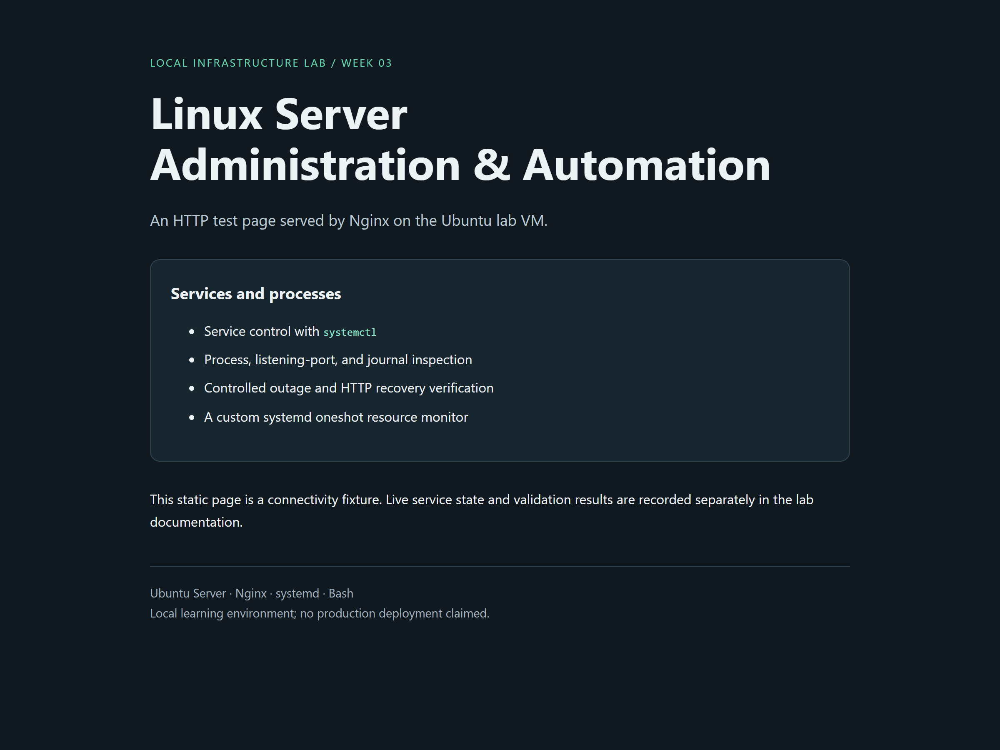
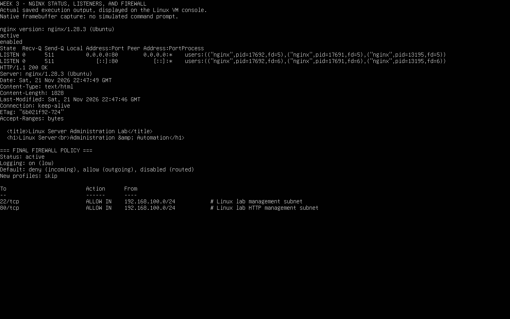
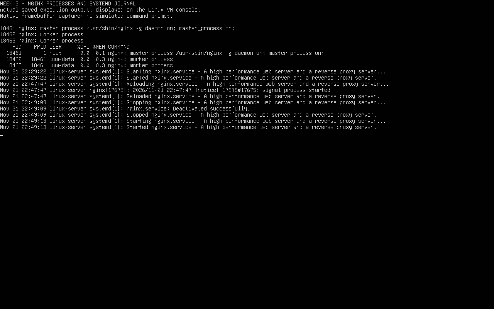
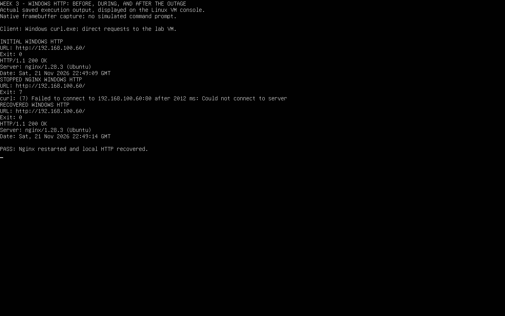
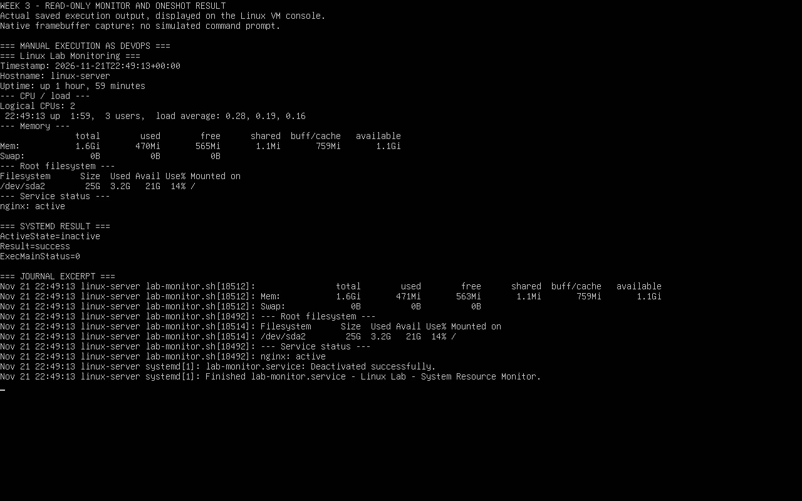
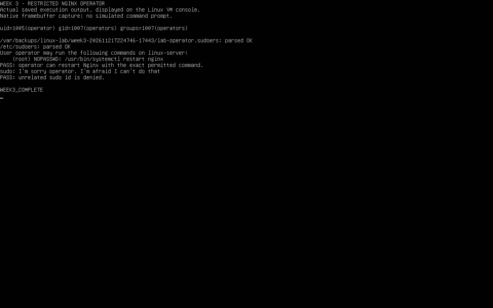

# 03 - Services and Processes

[Back to project overview](../README.md)

## At a glance

| State | Result |
| --- | --- |
| Completed | Nginx deployment, Windows HTTP access, process/log inspection, controlled recovery, custom monitor service, and restricted operator sudo |
| Verified | HTTP 200 before/after outage; connection refused during outage; monitor success; permitted restart and denied unrelated sudo |
| Evidence | Six new pointer-free captures linked below |
| Next stage | [Automation and recovery](04-automation.md): user report, backups, timers, and restore verification |

**Week 3 completed and verified on 2026-11-21.** This milestone is recorded in a local commit on 2026-11-22; it has not been pushed.

## Goal and environment

Deploy an HTTP service, interpret its processes and logs, recover from a controlled interruption, and run a read-only resource report through systemd.

The existing Ubuntu Server 26.04.1 VM uses a bridged adapter. Windows reaches the lab at `http://192.168.100.60/`. Nginx reports version 1.28.3; the installed package is `1.28.3-2ubuntu1.14`. These are observed lab values, not requirements for every deployment.

## Installed artifacts

| Repository artifact | Installed location |
| --- | --- |
| [Lab page](../configs/nginx/index.html) | /var/www/linux-lab/index.html |
| [Nginx server block](../configs/nginx/linux-lab.conf) | /etc/nginx/sites-available/linux-lab, linked from sites-enabled |
| [Monitor script](../scripts/lab-monitor.sh) | /usr/local/bin/lab-monitor.sh |
| [Monitor unit](../configs/systemd/lab-monitor.service) | /etc/systemd/system/lab-monitor.service |
| [Operator policy](../configs/sudoers/lab-operator) | /etc/sudoers.d/lab-operator |
| [Deployment/test script](../scripts/week3-services.sh) | Run with sudo from the lab staging directory |

The installed page, Nginx block, monitor script, and monitor unit were compared byte for byte with the local copies after the tests. The operator rule was syntax-checked with visudo and verified through sudo policy output and actual allowed/denied commands.

## Nginx and HTTP validation

The packaged default site was replaced by a lab server block serving root-owned static files from `/var/www/linux-lab`. Configuration validation passed with `nginx -t`; Nginx is active and enabled at boot. Port inspection showed listeners on IPv4/IPv6 port 80.

The Windows client received HTTP 200, and the downloaded response body exactly matched the repository HTML. The page was also opened in Brave on Windows. It is a static connectivity fixture, not a live monitoring dashboard.



UFW retained the week-2 SSH rule and added inbound TCP 80 only from `192.168.100.0/24`. Default incoming traffic remains denied and outgoing traffic allowed. The rule is for the actual bridged lab LAN, not a Host-only network. No IPv6 HTTP allow rule was added; the presence of an IPv6 listener alone does not mean the firewall permits it.



## Processes and journal interpretation

```bash
systemctl is-active nginx
systemctl is-enabled nginx
pgrep -a nginx
ps -C nginx -o pid,ppid,user,%cpu,%mem,args
sudo ss -ltnp '( sport = :80 )'
sudo journalctl -u nginx -n 18 --no-pager
```

A service is the systemd-managed lifecycle and policy; a process is an individual running program with a PID. The capture records one root-owned Nginx master and two www-data worker processes. Worker PPIDs point to the master. CPU and memory percentages are point-in-time observations, not performance benchmarks. A restart creates new PIDs, so the captured IDs should not be expected to remain current.

The journal records reload, stop, deactivation, and successful start events. It provides the transition history that a single active-state query cannot show.



## Controlled interruption and recovery

The deployment script coordinated independent Windows requests with its root-controlled service actions. During the stopped phase it waited at most 45 seconds for the client acknowledgement, and an exit trap restarts Nginx if the exercise aborts.

| Phase | Server result | Windows curl result |
| --- | --- | --- |
| Before interruption | Nginx active; local HTTP 200 | Exit 0, HTTP 200 |
| After systemctl stop nginx | Inactive; local curl exit 7 | Exit 7, connection refused |
| After systemctl start nginx | Active; local HTTP 200 | Exit 0, HTTP 200 |

The monitor also reported `nginx: NOT active` during the outage. After the optional operator restart, Windows performed the final successful HTTP check. The installer returned `WEEK3_COMPLETE` and left Nginx running.

The observed symptom was connection refusal when the service was stopped, not an HTTP application error. Local refusal, inactive state, matching journal events, and subsequent HTTP 200 established the cause and recovery.



## Custom monitor service

The Bash monitor reports timestamp, hostname, uptime, CPU count/load, RAM, root filesystem capacity, and Nginx state. Both active/inactive branches were exercised. It ran manually as devops and successfully through the installed oneshot unit.

The unit uses User=devops with NoNewPrivileges, ProtectSystem=strict, ProtectHome, and PrivateTmp. Reporting requires no root privileges. Its final state was:

```text
ActiveState=inactive
Result=success
ExecMainStatus=0
```

Inactive after a completed oneshot is expected. The journal contains the actual resource report and successful completion. No timer or continuous monitoring daemon is installed yet; scheduling belongs to week 4.



## Least-privilege operator

A locked local operator account belongs to operators and has no membership in sudo/admins/developers. Its root-owned sudoers file permits exactly:

```text
operator ALL=(root) NOPASSWD: /usr/bin/systemctl restart nginx
```

Visudo validation passed. Running that exact restart as operator succeeded; `sudo -n /usr/bin/id` was denied. Nginx configuration and unit files remain root-owned. The account is not included in the SSH allowlist.



## Deployment troubleshooting

The initial metadata refresh and package downloads were slow. APT was later observed in stopped state T+, and the original installer was no longer running after the resume step. Both Nginx packages were fully installed and dpkg audit was clean. The revised installer detected that state and skipped repeating downloads before completing configuration and tests. The cause of the process suspension was not established.

Systemd unit verification printed warnings about removed CPUAccounting settings in distribution xfs_scrub units. The lab monitor itself was installed and executed successfully, as shown by its result and journal. No unrelated distribution unit was edited.

## Evidence and scope

The first image is a browser-native screenshot of the actual page served to Windows. The other five are native VirtualBox framebuffer exports displaying actual saved privileged-script and Windows-client execution records, with no simulated prompts. Raw logs remain local and ignored by Git. Captures contain no private keys or passwords.

This lab uses HTTP within its management LAN; TLS and internet deployment are outside this stage. Scheduled monitoring, the user-report/backup scripts, daily backup timer, retention checks, and restoration remain in [week 4](04-automation.md).
