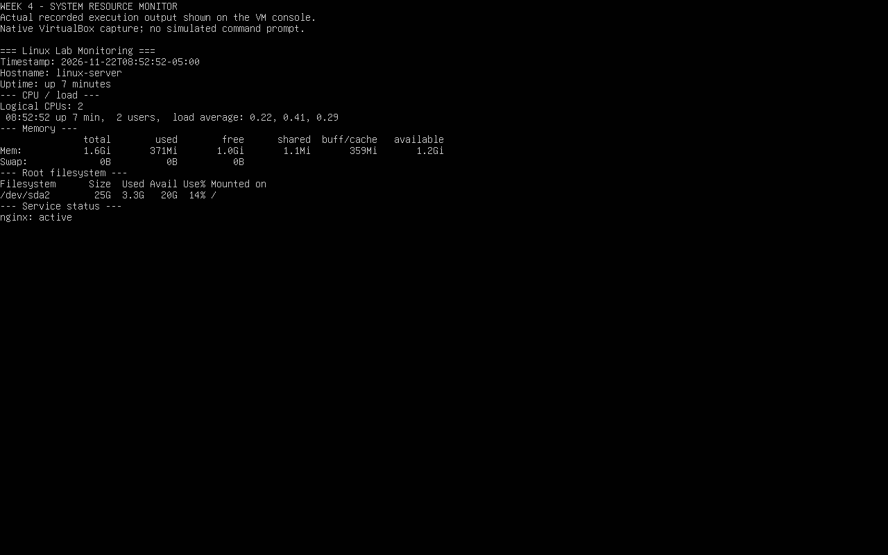
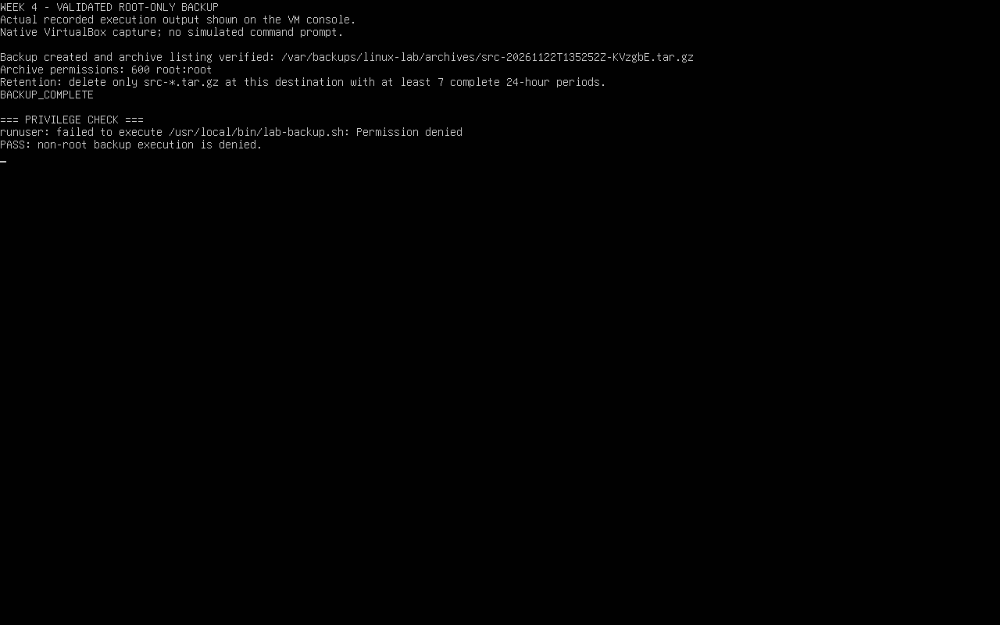
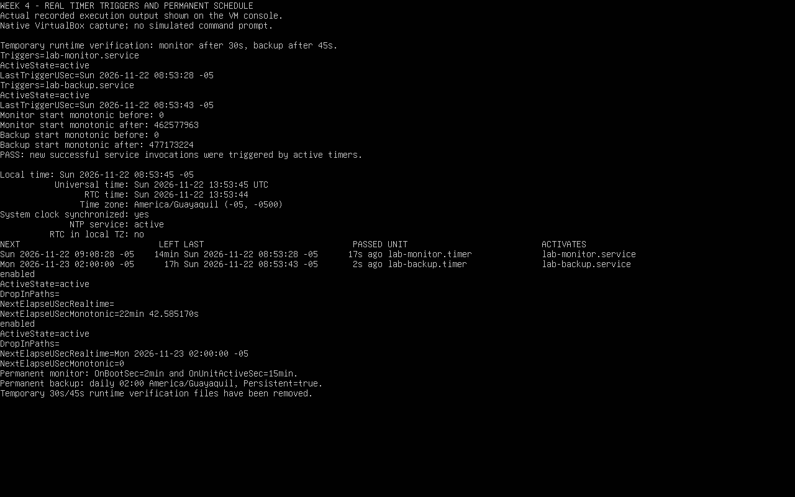
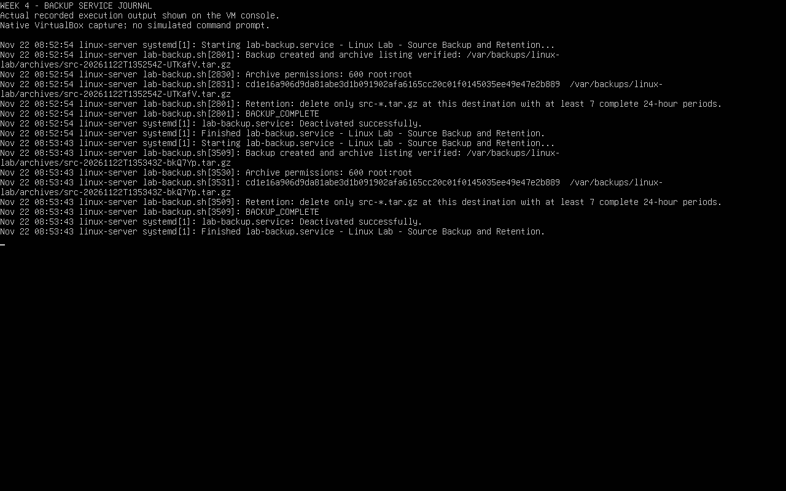
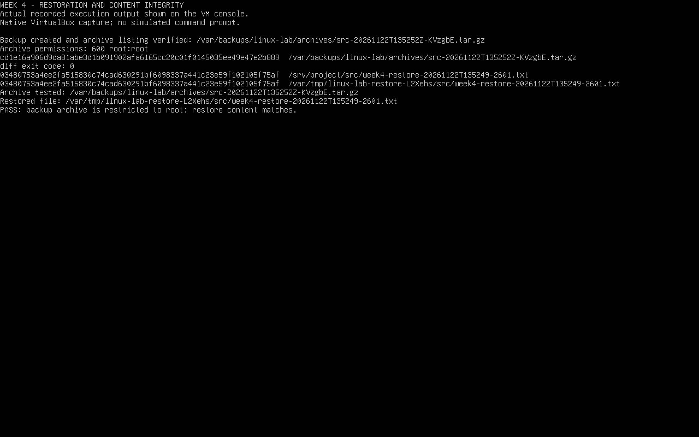
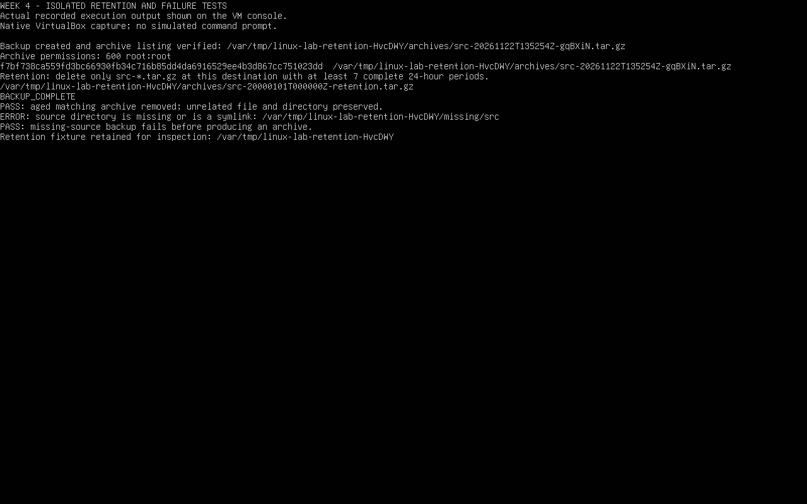

# 04 - Bash Automation and Recovery

[Back to project overview](../README.md)

## At a glance

| Deliverable | Verified result |
| --- | --- |
| Three Bash scripts | Monitor, user report, and backup installed and executed |
| Two services | Monitor and backup oneshots returned success and exit code 0 |
| Two timers | Enabled, active, and verified through actual automatic invocations |
| Backup | Compressed source archive validated, mode 600, root-only directory |
| Recovery | Separate-directory restore matched the unchanged source: diff exit 0 and identical SHA256 |
| Retention and failure tests | Aged matching fixture deleted; unrelated entries preserved; missing source and non-root execution rejected |
| Repository parity | Eight installed script/unit/reference hashes match the local files |

**Core automation stage completed on 2026-11-22.** The final installer returned `WEEK4_COMPLETE` and `CORE_LAB_ACCEPTANCE_PASSED` after independent SSH and Windows HTTP checks.

## Installed artifacts

| File | Purpose | Installed location |
| --- | --- | --- |
| [lab-monitor.sh](../scripts/lab-monitor.sh) | Read-only resource and Nginx state report | /usr/local/bin/lab-monitor.sh, root-owned mode 755 |
| [user-report.sh](../scripts/user-report.sh) | UID-based candidates and lab groups | /usr/local/bin/user-report.sh, root-owned mode 755 |
| [lab-backup.sh](../scripts/lab-backup.sh) | Compression, validation, locking, and scoped retention | /usr/local/bin/lab-backup.sh, root-owned mode 750 |
| [lab-monitor.service](../configs/systemd/lab-monitor.service) | Monitor oneshot as devops | /etc/systemd/system/lab-monitor.service |
| [lab-monitor.timer](../configs/systemd/lab-monitor.timer) | Boot and periodic monitoring | /etc/systemd/system/lab-monitor.timer |
| [lab-backup.service](../configs/systemd/lab-backup.service) | Root backup with restricted write scope | /etc/systemd/system/lab-backup.service |
| [lab-backup.timer](../configs/systemd/lab-backup.timer) | Daily persistent scheduling | /etc/systemd/system/lab-backup.timer |

The [week-4 installer](../scripts/week4-automation.sh) records prior state, installs matching copies, and runs the actual acceptance tests. The installed English [directory reference](../configs/project/README-structure.txt) matches `/srv/project/README-structure.txt`.

## Monitoring and user reporting

The monitor reports timestamp, hostname, uptime, logical CPUs/load, memory, root filesystem capacity, and Nginx state. It runs as devops without privileged writes. Its active/inactive Nginx branches were already exercised in stage 03; it was executed again for this stage.



The user report selects `1000 <= UID < 65534` and reports developers, operators, auditors, and admins. This UID range is a heuristic for human-user candidates, not proof that every account is a person or may log in. The group database member field contains supplementary memberships; an empty field does not exclude users whose primary group is that group.


## Backup implementation and access

The source is `/srv/project/src`, adapting the guide's engineering directory to the existing lab. Archives are stored under `/var/backups/linux-lab/archives`, a root-owned directory with mode 700. This separates archives from the earlier setup-state directories under `/var/backups/linux-lab`.

The backup script:

1. Validates the source, destination, root privileges, and retention input.
2. Takes a per-destination flock lock.
3. Creates a mode-600 temporary archive and validates its listing with tar.
4. Publishes it atomically with a hard link that refuses replacement.
5. Records its SHA256 and applies prefix/age-scoped retention.

Names use UTC timestamps and a unique suffix. The archive stores a relative `src/` tree, not the entire server. GNU tar's default symlink behavior is retained; links are not followed to copy unrelated external trees.

The unit runs as root with UMask=0077, NoNewPrivileges, PrivateTmp, ProtectHome, and ProtectSystem=strict. Its write exception is `/var/backups/linux-lab`. An unprivileged attempt to execute the installed backup and an attempt to read the archive were denied.



## Scheduling and real trigger verification

The server timezone is America/Guayaquil (UTC-05). Permanent scheduling is:

| Timer | Permanent settings |
| --- | --- |
| Monitor | OnBootSec=2min; OnUnitActiveSec=15min |
| Backup | OnCalendar=*-*-* 02:00:00; Persistent=true |

To test automatic execution during the session, the installer temporarily added runtime OnActiveSec delays of 30 seconds for the monitor and 45 seconds for the backup. Both timers triggered fresh successful service runs. New monotonic start timestamps, LastTrigger values, and journal entries establish those automatic invocations separately from manual runs.

The temporary runtime files were removed afterward. Both DropInPaths properties were empty, and the permanent next backup was reported as **2026-11-23 02:00:00 -05** at the validation checkpoint. This proves the tested trigger mechanism and final configuration; it does not claim that an overnight 02:00 run was observed during the session.

Both timers are enabled and active. A completed oneshot being inactive is expected; success is established with Result=success and ExecMainStatus=0.





## Restore and content-integrity test

A unique reference file was created before backup, then left unchanged for comparison.

| Item | Observed value |
| --- | --- |
| Tested archive | src-20261122T135252Z-KVzgbE.tar.gz |
| Source file | /srv/project/src/week4-restore-20261122T135249-2601.txt |
| Restore directory | /var/tmp/linux-lab-restore-L2Xehs/ |
| Comparison | diff exit code 0 |
| Both file SHA256 values | 03480753a4ee2fa515830c74cad630291bf6098337a441c23e59f102105f75af |

Archive filenames use UTC; scheduling and the final reports use Guayaquil time. The differing hour in a filename is intentional.

The file was restored into a separate root-restricted temporary directory. Matching file hashes support the actual diff result. Archive readability alone was not treated as recovery proof.



## Retention and failure tests

Retention is age-based, not a fixed archive count: with the default seven-day setting, only matching source-prefixed tar.gz files in the destination's top level are removed after at least seven complete 24-hour periods. Setup-state directories, lock files, partial files, and unrelated archive names do not match.

The test used a new disposable fixture under `/var/tmp/linux-lab-retention-HvcDWY`. A valid matching archive's mtime was deliberately set ten days old, as was an unrelated file. A subsequent backup removed the aged matching archive and preserved the unrelated file and directory. This is an isolated age simulation, not a claim that ten days elapsed. A missing-source test failed before producing an archive.

The explicit `--source`, `--destination`, and `--retention-days` options support such root-controlled isolated tests. Production units use the fixed lab defaults.



## Routine operations

Run these inside Ubuntu; backup/service changes require sudo:

```bash
/usr/local/bin/lab-monitor.sh
/usr/local/bin/user-report.sh
sudo systemctl start lab-backup.service
systemctl list-timers --all
sudo journalctl -u lab-monitor.service -n 25 --no-pager
sudo journalctl -u lab-backup.service -n 25 --no-pager
sudo ls -lh /var/backups/linux-lab/archives/
```

The installer is an acceptance/deployment workflow, not the everyday backup command. Do not copy real archives, private keys, or raw local logs into Git.

## Evidence and limits

The seven images are native VirtualBox framebuffer exports displaying actual recorded execution output. Captures contain no Windows mouse pointer or simulated prompts. Raw logs and real archives remain outside version control.

This is a local lab with local backups and HTTP on its management LAN. Off-host/encrypted backups, alerting, CI, and cloud deployment are optional extensions. At closeout the existing APT metadata reported **114 available package updates**; the user explicitly chose to record them as maintenance instead of upgrading Ubuntu. Core lab completion does not mean the OS is fully patched or production-ready.
