# 05 - Filesystem Operations

[Back to project overview](../README.md)

## At a glance

| State | Meaning |
| --- | --- |
| Already documented | Filesystem exercises and 13 original captures are documented. |
| Remaining | Core follow-up complete: shared-source permissions reconciled, symlink target verified, and directory reference translated. |
| Stage status | Supplementary work; this is not week 5. |

## Goal and status

Organize service data, inspect storage, and test Linux access controls. This supplementary chapter preserves the original filesystem milestone alongside the guide's four core stages.

## Recorded layout

The original filesystem notes describe the historical model below. The final shared-source policy is now `2770 devops:developers`, verified in [stage 02](02-users-permissions.md); the historical tree is retained to explain the earlier exercise:

```text
/srv/project/
|-- src/               devops:devops, 755
|   |-- app/
|   |-- tests/
|   `-- scripts/
|-- config/            root:devops, 750
|-- logs/              directory 755, files 644
|-- backups/           root:root, 700
`-- tmp/               root:root, 1777

/etc/project/          System configuration
/var/log/project/      Project service logs
/opt/project/bin/      Project executables
```

| Directory | Recorded policy | Purpose |
| --- | --- | --- |
| `src/` | Owner writes; group and others read/traverse | Owner-managed source tree |
| `config/` | Root writes; devops group reads/traverses | Restricted configuration |
| `logs/` | Directory 755, files 644 | Owner writes; other accounts read |
| `backups/` | Root-only access | Restrict archive access |
| `tmp/` | World-writable with sticky bit | Shared temporary files with restricted deletion |

This historical model differed from the earlier shared-development exercise. The live check found `2755 devops:devops`; stage 02 corrected it to `2770 devops:developers` and verified shared developer access. The new audit directory and its read-only role are documented there.

## Observed access-control test

The sticky-bit capture shows `devops` creating a file under `/srv/project/tmp`, then a temporary `testuser` trying to remove it. Removal fails with `Operation not permitted`. The administrator subsequently removes the test account.

The sticky bit restricts deletion and renaming to the file owner, directory owner, or a privileged account. It does not make a world-writable directory private or prevent changes to writable file contents.

## Symlink and filesystem placement

The lab creates `/srv/project/config/app.conf` as a symlink to `/etc/project/app.conf`, keeping configuration in `/etc` with a project-local reference.

The exercises use `/srv` for service data, `/etc` for configuration, `/var/log` for logs, and `/opt` for application files. Temporary-file cleanup depends on host policy; a path under `/tmp` alone does not prove deletion on every reboot.

## Command reference

| Command | Purpose |
| --- | --- |
| `tree -p /srv/project` | Inspect tree and permissions |
| `du -sh /srv/project/*` | Summarize directory space usage |
| `df -hT` | Inspect capacity and filesystem types |
| `df -i` | Inspect inode usage |
| `find /srv/project -type f -name '*.py'` | Find Python files |
| `find /srv/project -mtime -1` | Find recently modified entries |
| `find /srv/project -type f -perm 644` | Find files with an exact mode |
| `find /srv/project -type f -size +1M` | Find files larger than 1 MiB |
| `readlink -f /srv/project/config/app.conf` | Resolve the symlink |
| `findmnt` | Inspect active mount points |
| `lsblk` | Inspect block devices |
| `chmod 1777 /srv/project/tmp` | Apply shared temporary-directory permissions |

Mount screenshots document inspection of mounts and `/etc/fstab`; they do not establish a new persistent mount or a reboot test.

## Evidence

### Filesystem exploration

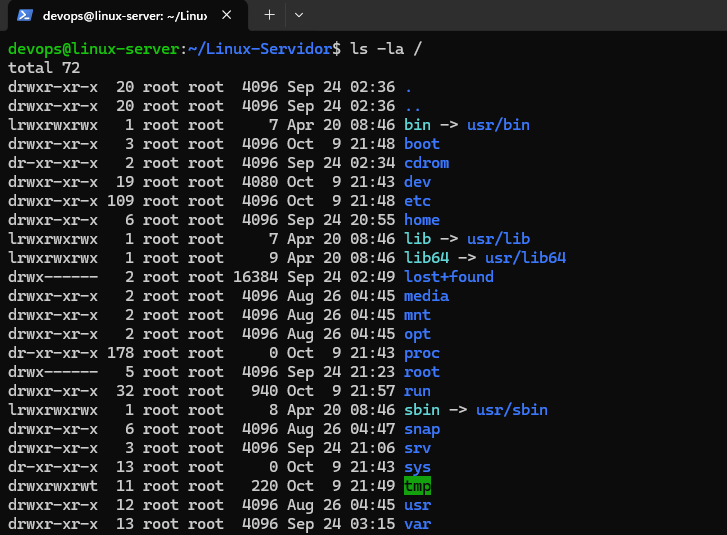

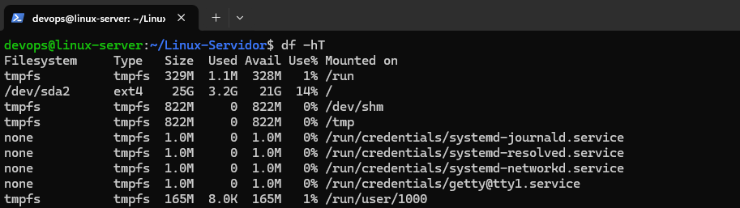

### Layout and permissions

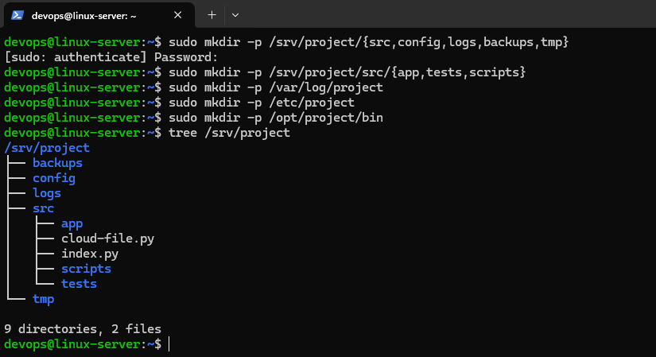

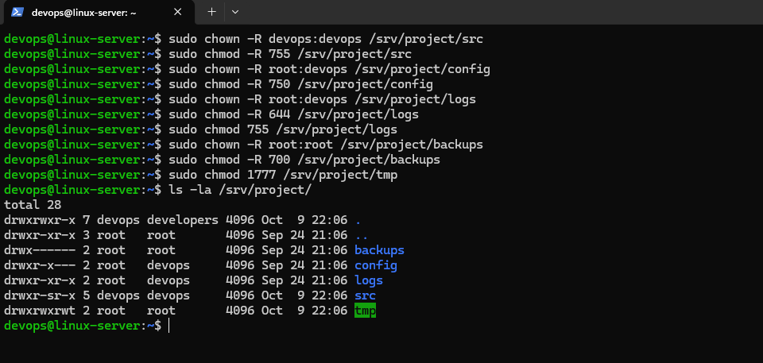

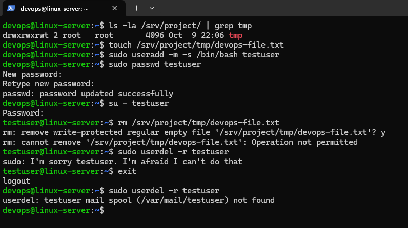

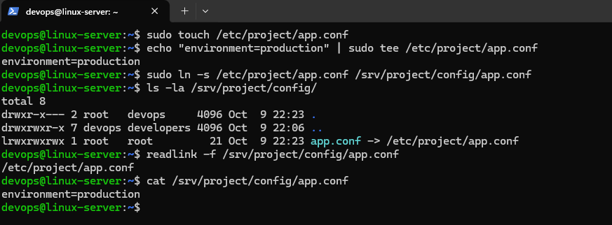

### Search and storage

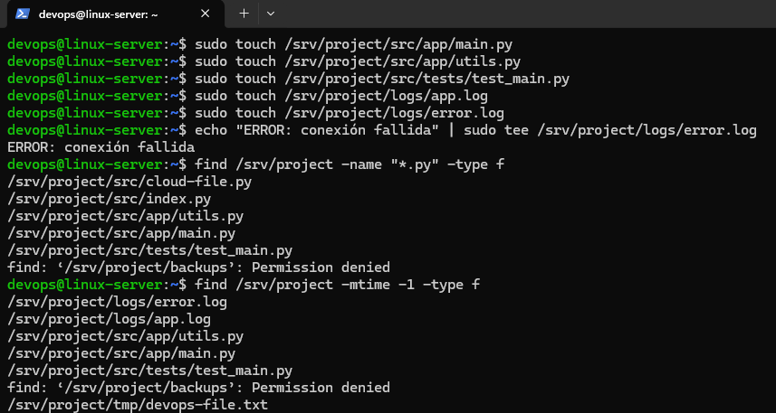

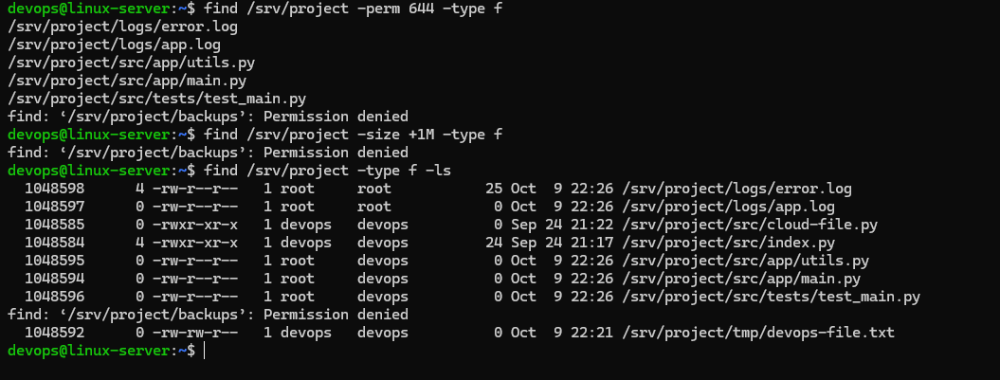

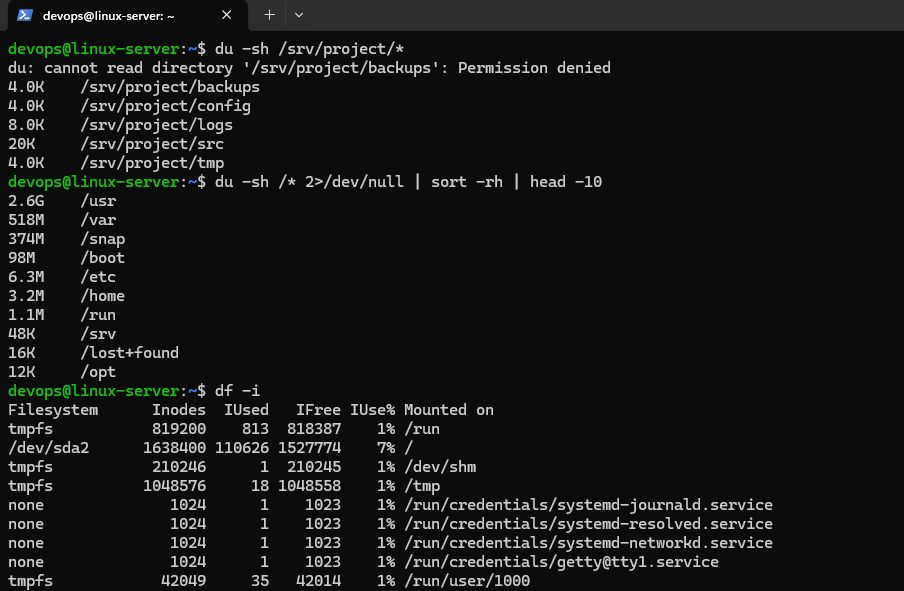

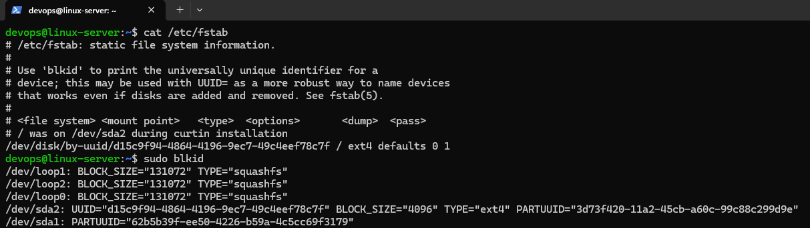

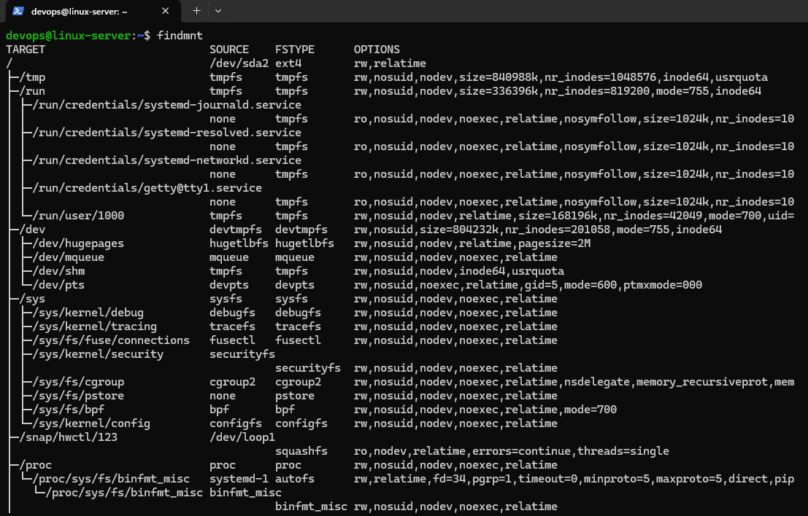

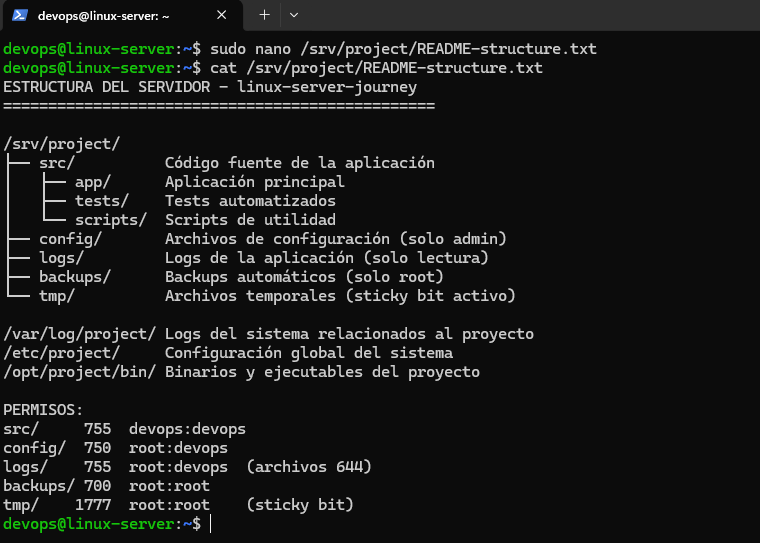

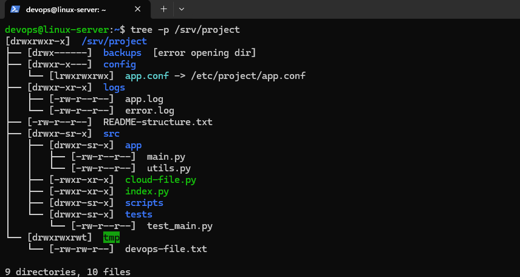

## Final follow-up

Ownership reconciliation is complete in [stage 02](02-users-permissions.md). Final closeout verified that the configuration symlink target exists and installed the matching English [directory reference](../configs/project/README-structure.txt) as /srv/project/README-structure.txt. Original captures remain historical evidence; final automation/recovery results are in [stage 04](04-automation.md).
